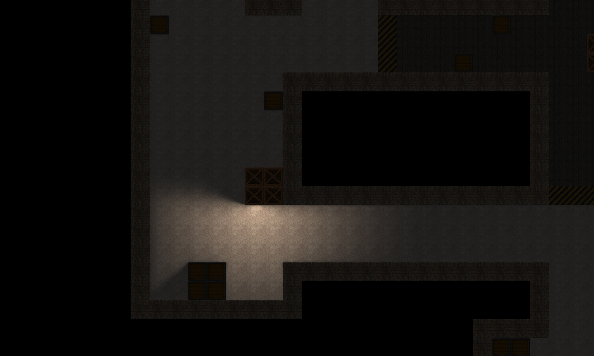
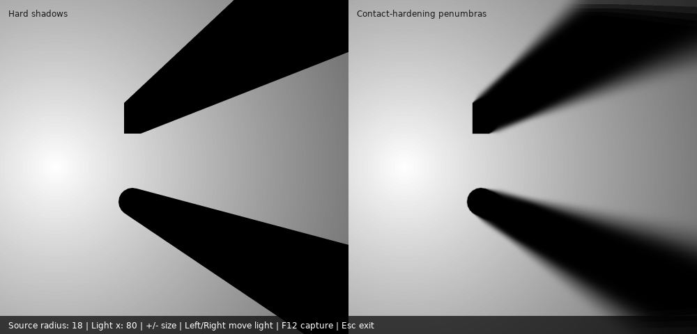
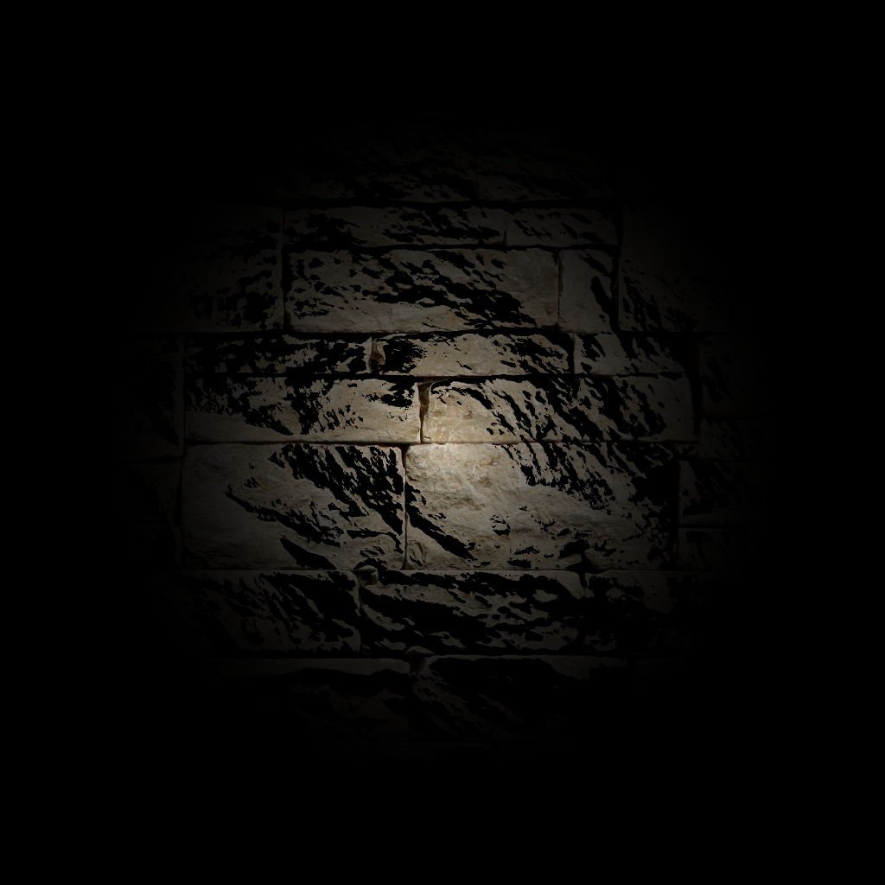
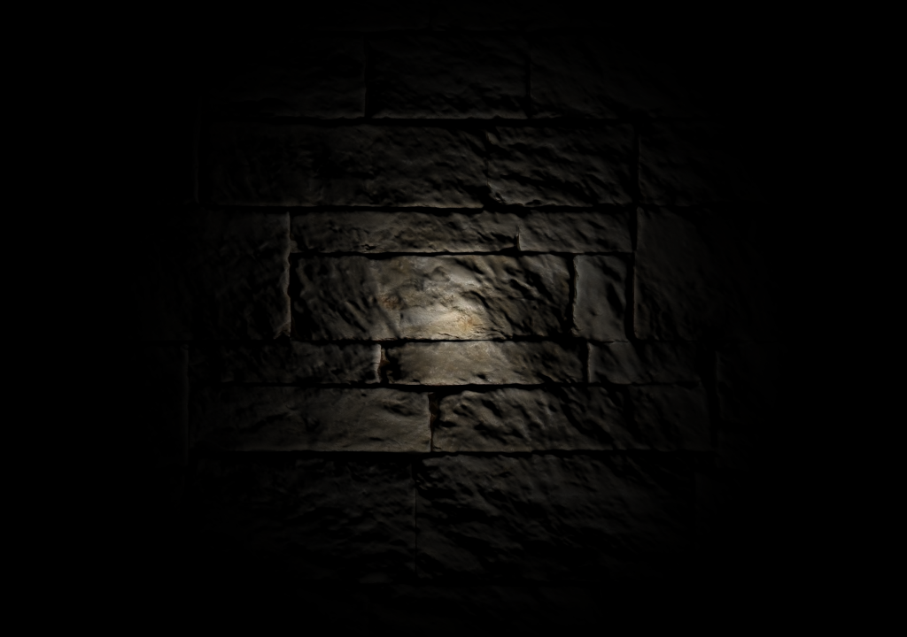
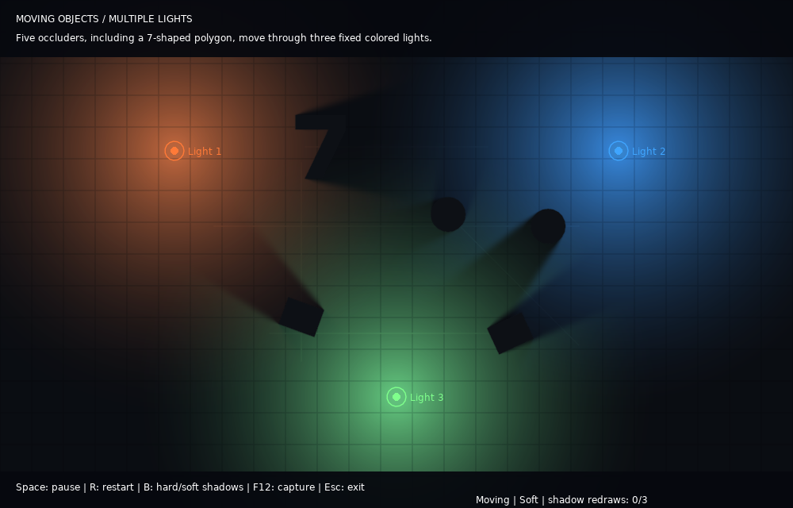
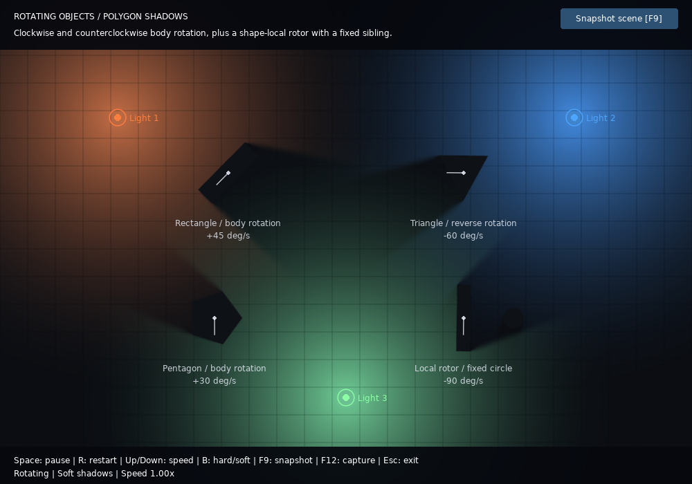
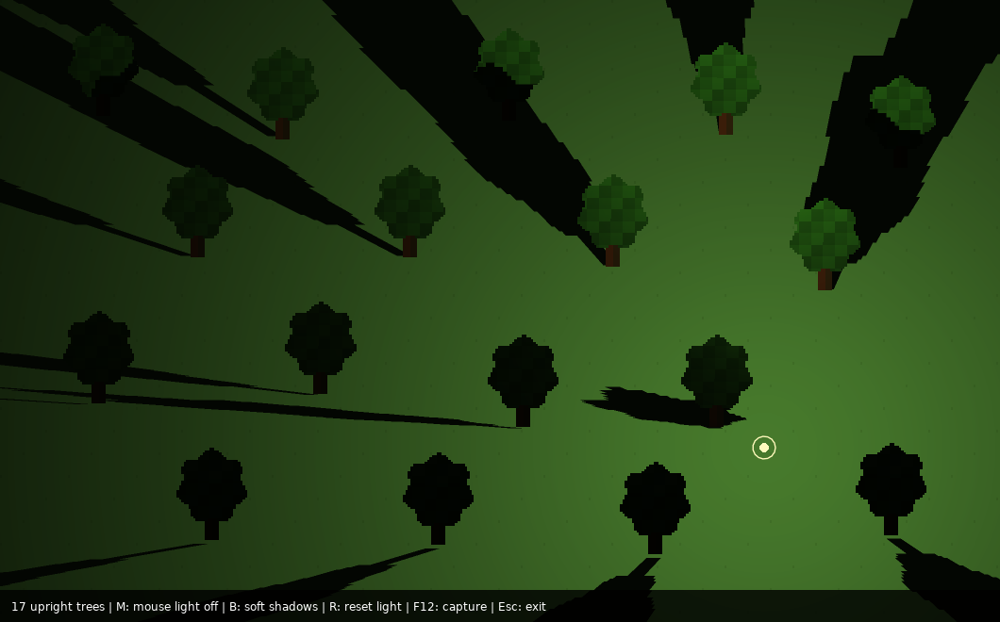
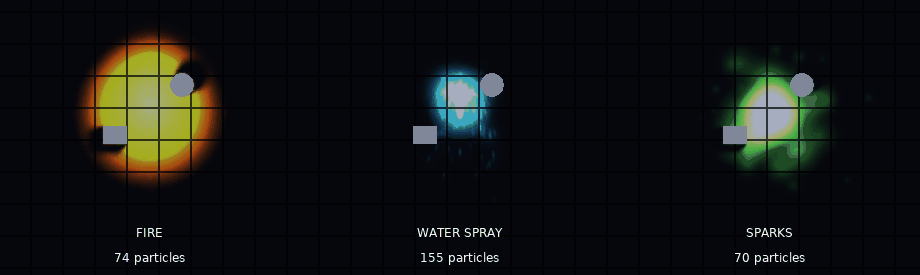

# Shädows

Shädows is a dynamic lighting and shadow library for LÖVE. It supports height-aware polygon and circle occluders, textured shadows, ambient-darkening rooms, and normal- and height-map effects.

[`ParticleLight`](docs/ParticleLight.md) adds dynamic illumination from a native
LÖVE `ParticleSystem`, including its texture, motion, colors, and alpha. Particles
light the scene additively through emitter-centered hard or soft shadows while
reusing cached shadow geometry. Pass `dt` to `world:Update(dt)` to animate them;
omit it when updating emitters yourself. See the `ParticleLights` demo for fire,
water spray, and sparks.

Soft shadows use contact-hardening penumbras: edges stay sharp near the casting
shape and soften with distance from its silhouette. A minimum softness keeps
penumbras visible for positive source sizes even when the light is far from the
caster; larger sources can add more softness. The filter uses 90% of its
estimated radius for a slightly tighter transition, while 4x MSAA continues to
antialias diagonal silhouettes. Set `light.SizeRadius` (default `10`, in world
units) to control softness; `light.Blur = false` or
`light.SizeRadius = 0` preserves hard shadows.
The filter searches toward the light for a relevant blocker to avoid abrupt
softness changes where an unrelated nearby wall becomes the nearest silhouette,
including bright streaks along walls adjacent to a penumbra. It blends
candidate footprints and smooths the estimated blur radius to reduce bright
lines when the search crosses surfaces. Filtering excludes caster-covered
samples so lit walls do not bleed into shadows where they meet.
This applies to local lights and full-scene stars. See [Penumbras](docs/Penumbras.md)
for the filtering approximation, graphics requirements, and comparison demo.
Projected shadow render targets and occluder-mask canvases request 4x MSAA to smooth diagonal
edges, including when soft-shadow filtering is disabled.

## Cached updates

Lights retain a shared shadow canvas and cache projected geometry per shape and
height layer. Shape edits rebuild only that shape's geometry; moving a body
rebuilds its shapes. Local lights redraw shadows only when their influence
intersects a changed shape's previous or current bounds. Full-scene stars
redraw on scene changes. Affected canvases are still redrawn completely to
preserve overlapping shadows and height ordering.

Color, angular coverage, and light rotation changes reuse shadow pixels.
Changing `SizeRadius` reuses the occluder-distance field and updates only filter
radii and illumination. Changing the light position or radius rebuilds shadows;
local-light canvases resize with the radius.

Call `world:ForceUpdate()` when custom shadow/sprite callback output changes or
an existing texture's pixels change in place. Custom callbacks are not invoked
for appearance-only recomposition; force an update if they depend on light color,
arc, or rotation. See [Light](docs/Light.md) for rendering details.

## Rendering quality

Each world exposes a shared `world.Settings` object used by all its lights and
stars. Call `world.Settings:SetQuality("low" | "medium" | "high", overrides?)`
to adjust shadow resolution, projected-edge MSAA, and penumbra-buffer
resolution together. `world:SetQuality(...)` remains a shorthand. The default
`high` preset preserves full-resolution, 4x MSAA rendering. See the
[LightWorld API](docs/LightWorld.md) for preset values and usage.

## Light cookies

Use `light:SetCookie(texture)` to mask illumination with a centered RGB/alpha
texture while preserving falloff, cones, tint, and shadows.
`light:SetCookieTransform(x?, y?, angle?, scaleX?, scaleY?)` controls light-local
offsets, relative rotation, and scale; the default aspect-preserving footprint
fits the light diameter. `SetCookie(nil)` disables the mask. Cookie changes
reuse shadow geometry and buffers, work with stars and particle lights, and do
not change the light radius or legacy `SetImage` behavior. See
[Light and Star](docs/Light.md#light-cookies) for mask semantics and texture updates.

## Multiple lighting views

[`LightCamera`](docs/LightCamera.md) provides independent position, zoom, and
resizing for multiple views of one world. Local lights share their cached
canvases; stars have separate shadow and penumbra buffers per camera.
Star textures follow the light's world position and each camera's zoom.
`world:Update(dt)` advances simulation once and refreshes every registered view.
Each camera submits only local-light canvases intersecting its viewport, using
conservative square bounds to preserve texture and particle illumination.
Local-light changes refresh cameras containing the previous or current light;
moving or resizing a camera refreshes only that view and its star buffers.
Ambient color, room changes, and shared quality settings still refresh all views.

```lua
local LightCamera = require("shadows.LightCamera")
local left = world:GetCamera()
left:Resize(400, 300)
local right = LightCamera:new(world, 400, 300)
right:SetPosition(600, 200, 0.5)

-- After drawing the scene with each camera's matching transform:
left:Draw(0, 0)
right:Draw(400, 0)
```

Existing `world:SetPosition`, `world:Resize`, `world:Draw`, and `world.Canvas`
continue to use the default camera. Resize additional views independently when
your screen layout changes. Camera positions are not automatically snapped:
use the same effective translation and zoom as your scene renderer.
Each camera exposes `camera.Transform` and `camera:GetTransform()` for
hierarchical positioning and following a body or other transform. Camera
`SetPosition` uses world coordinates, even when parented. Parent motion is
synchronized before light culling and star rendering. Zoom remains separate
from transform height, and viewports stay axis-aligned.

## Debug overlays

[`DebugOverlay`](docs/DebugOverlay.md) draws light influence bounds and cone
directions, green occluder outlines, cached shadow-geometry wireframes, camera
viewports, and actual cache-work counters over an already-lit scene.
Create it with `DebugOverlay:new(world)` and call
`debug:Draw(camera?, screenX?, screenY?)` after applying lighting. Toggle its
`LightBounds`, `ShadowGeometry`, `CameraViewports`, and `CacheCounters` fields
independently. Drawing preserves graphics state and does not rebuild caches.
Textured/shader-based shadows show draw bounds rather than per-pixel contours.
The panel shows **per-frame, per-camera** star/composition CPU milliseconds,
shadow redraws, geometry/draw work, light composition submissions, and canvas
allocations. Shared local-light work has its own world-level section and is not
charged to every camera. `debug:GetFrameStats(camera?)` returns stable snapshots
from the last completed world update; `camera.FrameMetrics` and
`world.FrameMetrics` expose the same read-only records. Resize/quality
allocations between updates appear in the next frame. Timings are CPU values,
not GPU timings. Cumulative totals are secondary:
`debug.CumulativeTotals = true` appends them, and `debug:GetStats(camera?)`
retains its existing lifetime-counter and cache-size API.

## Color API migration

All light, star, ambient, and room color channels now use LÖVE's **0-1 range**.
This is a breaking change: divide legacy 0-255 arguments by 255 when updating
callers, including alpha (`255` becomes `1`). No legacy-range detection is
performed. For example, use `light:SetColor(1, 0.5, 0, 1)` for an orange light.
Radial lights apply RGB tint and opacity with premultiplied distance falloff.

## Source and setup

The editable library is in [`src/shadows`](src/shadows); its require name remains `shadows`. Add the source directory to LÖVE's require path before loading the library:

```lua
love.filesystem.setRequirePath(
    "src/?.lua;src/?/init.lua;" .. love.filesystem.getRequirePath()
)

local LightWorld = require("shadows.LightWorld")
local Light = require("shadows.Light")
local Body = require("shadows.Body")
local PolygonShadow = require("shadows.ShadowShapes.PolygonShadow")

local world
local light

function love.load()
    world = LightWorld:new()
    light = Light:new(world, 320)
    light:SetColor(1, 240 / 255, 200 / 255, 1)
    light:SetPosition(400, 300, 1.2)

    local body = Body:new(world)
    body:SetPosition(400, 300, 0.4)
    PolygonShadow:new(body, -32, -24, 32, -24, 32, 24, -32, 24)
end

function love.update(dt)
    world:Update(dt)
end

function love.draw()
    world:Draw()
end
```

The repository launcher and source demos configure the path for you. See the [API guide](docs/README.md) for all supported objects and methods.

## Demos

In VS Code, choose **Terminal > Run Task > Run LÖVE demo** and select a scene. Demos under `DEMOS/` load the shared library from `src/shadows`; they do not contain copies of the package.

The high-DPI regression scene can also be run from the repository root:

```powershell
love . HighDPI
love . HighDPI --capture
love . Penumbra --capture --verify
love . MovingObjects
love . MovingObjects --capture --verify
love . RotatingObjects
love . RotatingObjects --capture --verify
love . ImageShadow
love . ImageShadow --capture
love . CastImage
love . CastImage --capture --verify
love . ParticleLights
love . ParticleLights --capture --verify
love . LightCameras
love . LightCameras --capture --verify
love . DebugOverlay
love . DebugOverlay --capture --verify
love . LightCookies
love . LightCookies --capture --verify
```

Capture mode renders the scene to offscreen canvases at DPI scale 2, saves a screenshot using `love.graphics.captureScreenshot`, and exits. Press `F12` to capture an image interactively; press `Escape` to close the demo.

The `ParticleLights` demo uses three independent particle systems as actual
light sources, not just decorative particles over a radial light. Press `Space`
to pause or `B` to toggle soft shadows. Its verification checks changing
illumination while shadow pixels remain cached. Shadows originate at each
emitter, not at every particle. Particle randomness remains native to LÖVE;
capture mode uses a fixed simulation warm-up duration.
The blue water spray uses tapered droplet textures, velocity-aligned rotation,
and gravity-driven arcs; verification also measures its rising and falling light.

The `LightCameras` demo displays two independently positioned and zoomed views
of one animated scene, sharing a local light and a full-scene star. Press `Tab`
to select a camera, arrows to pan, `+`/`-` to zoom, `Q` to change shared quality,
`F` to toggle following the animated body with the selected camera's transform,
or `Space` to pause the body. `--verify` checks matching-view pixel equality,
shared scene movement, and incremental rendering against full rebuilds.

The `DebugOverlay` demo displays all four diagnostic categories in a main view
and overview. Press `1`-`4` to toggle categories, `D` to hide them all, `T` to
append/hide cumulative totals, `Space`
to pause caster motion, `C` for tint-only changes, `B` for hard/soft shadows,
or `R` to force a rebuild. Use arrows to pan the main camera.

The `LightCookies` demo uses original procedural window, cone/gobo, and ripple
masks on two local lights and a star. Press `Tab` to select a source, arrows to
offset its mask, `A`/`D` to rotate, `+`/`-` to scale, `C` to toggle the cookie,
`B` for hard/soft shadows, `Q` for quality, `R` to reset its transform, or `Space`
to pause pattern animation. Verification checks actual masking, transforms,
shadow-cache reuse, and exact pixel equality with full rebuilds.
The green gobo uses a 512-pixel, supersampled and mipmapped mask with gently
feathered apertures to avoid blocky projection edges without blurring shadows.

The `Penumbra` demo compares hard and soft polygon/circle shadows side by side;
press `Q` to change the shared quality preset in both scenes, use `+` and `-`
to adjust the source radius, and use the arrow keys to move the light.
`--verify` checks measured contact and distant transition widths, minimum softness
at different source sizes and light distances, brightness preservation,
hard-shadow behavior, and DPI scales 1 and 2. Capture failures print a traceback and exit with a
nonzero status instead of opening an interactive error screen.
The same command checks granular cache work counts and exact pixel equality
between incremental updates and forced full rebuilds, including movement,
resizing, removal, texture replacement, tracked parents, and camera changes.

The `MovingObjects` demo continuously moves five circle/polygon objects,
including a concave 7-shaped polygon, back and forth under three fixed lights
at different positions, colored orange, blue, and green. Motion paths and light
markers show the scene layout; a counter reports
shadow-canvas redraws. Press `Space` to pause, `R` to restart, and `B` to switch
between hard and soft shadows. Capture mode uses a deterministic animation pose.
`--verify` checks both directions of motion, a complete loop, shadows from every
light, cache reuse while stationary, and pixel equality with forced rebuilds.
It also checks the seven's top bar, diagonal stem, and open notch throughout
its movement cycle, including hard-shadow rendering and unobstructed notch visibility.
Concave polygons are triangulated for silhouette drawing and shadow projection,
so the seven retains its open notch instead of being filled as a convex shape.

The `RotatingObjects` demo spins a rectangle, triangle, and pentagon in both
directions under three colored lights. A fourth example rotates only a polygon
inside its body while its circle sibling stays fixed. Pivot markers show
orientation. Press `Space` to pause, `R` to restart, `Up`/`Down` to adjust speed,
and `B` to toggle hard/soft shadows. `--verify` checks signed rotation angles,
full-loop periodicity, the fixed sibling, shadows from all three lights, and
pixel equality with full rebuilds for both hard and soft shadows.
Polygon shadow contours follow silhouette boundary order for lights below the
caster, preventing crossed triangles and missing shadow wedges as objects rotate.
The rotating-demo regression also checks the recorded pentagon defect at
89.706888 degrees and interior occlusion throughout a complete rotation.
Click **Snapshot scene [F9]** or press `F9` to pause and save a matching
`rotating-scene.png` and `rotating-scene.txt` without closing the demo. The text
records animation time, exact body/shape rotations, local and world polygon
vertices, all light settings, and window/canvas DPI. Both files are written to
the LÖVE save directory (on Windows, `%APPDATA%\LOVE\shadows`); the full path is
printed to the console. Share both files to reproduce an issue. The next
snapshot overwrites them; press `Space` to resume. Run
`love . RotatingObjects --capture --snapshot-verify` to validate the button and
matching screenshot/state output using temporary files.

The `ImageShadow` demo casts the silhouette and colors of a transparent flower
image onto a softly lit surface. Move the mouse to reposition the light, press
`B` to toggle soft shadows, `F12` to capture a screenshot, or `Escape` to exit.

The `CastImage` demo recreates a forest lighting scene with 17 original pixel-art
trees. Each upright tree casts an alpha-silhouette ground shadow, becomes dark
when backlit, and receives shadows from other trees. Press `M` to follow the
mouse with the light, `R` to reset it, or `B` to toggle soft ground shadows.
`--verify` checks every tree rather than a single representative caster.

Use [`CastImageShadow`](docs/CastImageShadow.md) for upright sprites, rather than
the flat textured mask provided by `ImageShadow`. Its bottom-center anchor is
the body's ground position; its height is measured in world units. Draw sprites
with `shape:DrawSprite()` in ground-depth order **after** `world:Draw()`, so
their illumination is not multiplied by their own ground shadows.

In the `Standard` demo, click **Snapshot scene [F9]** or press `F9` to save a
matching screenshot and scene settings (`standard-scene.png` and
`standard-scene.txt`) for reproducing lighting issues. See
[Standard demonstration](docs/Standard-Demonstration.md) for the save location
and controls. The demo aligns its lighting camera with the tile renderer's
pixel-snapped translation so shadows stay attached to the visible walls.

## Lighting showcase

Scenes captured from the included demos, showing map lighting, contact-hardening
penumbras, height-map shadows, normal-map lighting, moving/rotating occluders under
multiple colored lights, upright image casters, and animated particle lights.

| Standard map lighting | Contact-hardening penumbras |
| --- | --- |
|  |  |

| Height-map shadows | Normal-map lighting |
| --- | --- |
|  |  |

### Moving objects and multiple lights

Five objects, including a 7-shaped polygon, oscillate back and forth under three
fixed, colored lights in the
[`MovingObjects` demo](DEMOS/MovingObjects/main.lua).



### Rotating polygons

Clockwise and counterclockwise polygons cast changing shadows, with a separate
shape-local rotor and stationary circle in the
[`RotatingObjects` demo](DEMOS/RotatingObjects/main.lua).



### Upright trees casting and receiving shadows

Seventeen pixel-art trees project their alpha silhouettes onto the grass, become
dark when backlit, and receive shadows from other trees in the
[`CastImage` demo](DEMOS/CastImage/main.lua).



### Animated particle lights

Fire, gravity-driven water droplets, and green sparks illuminate a tiled surface
through cached emitter-centered shadows in the
[`ParticleLights` demo](DEMOS/ParticleLights/main.lua).



## Tests

Run Busted **inside LÖVE** from the repository root, using an x64 LuaJIT-compatible
rocks tree:

```powershell
powershell -NoProfile -ExecutionPolicy Bypass -File spec\run.ps1
powershell -NoProfile -ExecutionPolicy Bypass -File spec\run.ps1 -Specs spec\love\Lighting_spec.lua
```

See [BUSTED.md](BUSTED.md) for reproducible Windows x64 setup with LuaRocks,
LOVE's matching LuaJIT, MSVC, native-DLL verification, focused standalone unit
tests, and launcher options. An existing compatible `%LOCALAPPDATA%\LuaRocks-love`
installation can be reused. VS Code also provides a **Run Busted tests** task.

Focused specs under `spec/` cover DPI lookup, penumbra settings, hierarchical
transforms, and equal-height queue ordering. `spec/love/` adds actual rendering
checks for first-update shadows, color-only cache reuse, moved-body incremental
versus forced rebuilds, and soft-shadow radius changes. The test game saves
`%APPDATA%\LOVE\shadows-tests\screenshots\first-update-shadow.png` before its
pixel assertions. Its configuration and bootstrap live in `spec/busted-love/`;
the launcher assembles a temporary game without changing the demos or library.

Use the launcher for the complete suite, not `busted --lua love` or standalone
`busted`. The existing demo capture/verification commands remain supplemental
end-to-end checks.

## Documentation

Start with the [API and usage guide](docs/README.md), which indexes the class references and demonstrations in `docs/`.

## Project links

- [Issues](https://github.com/matiasah/shadows/issues)
- [LÖVE forum thread](https://love2d.org/forums/viewtopic.php?f=5&p=200615)
