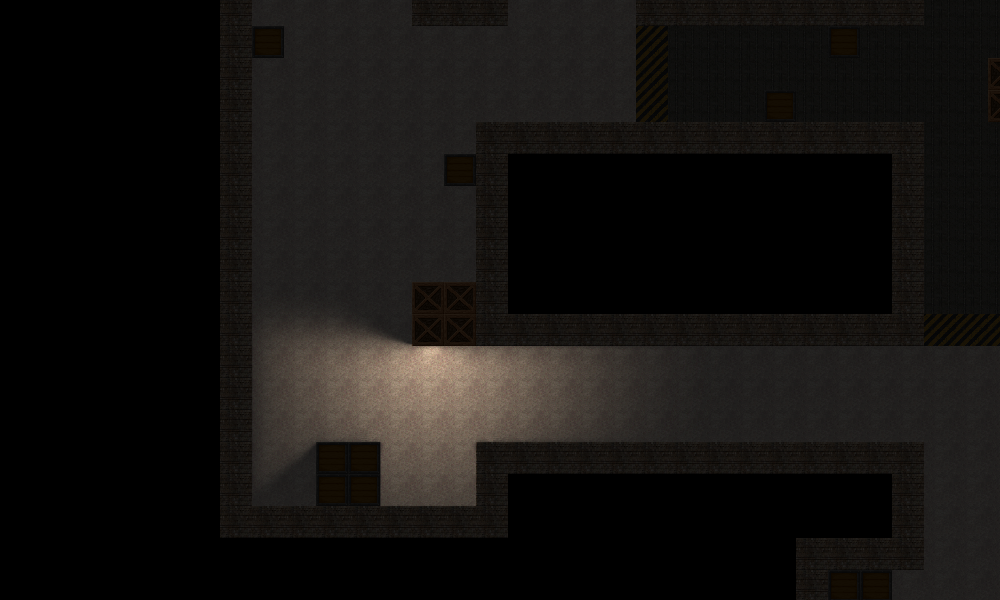
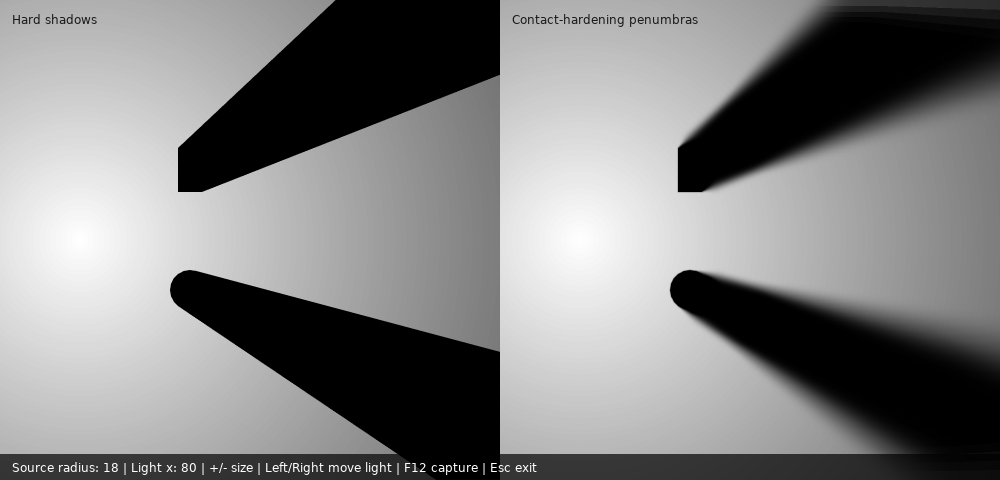
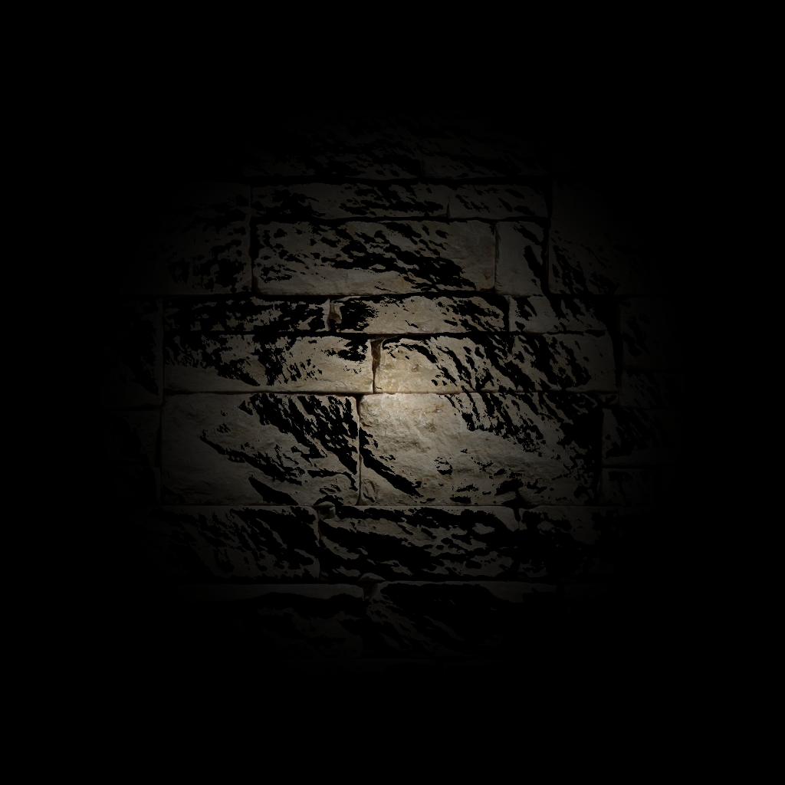
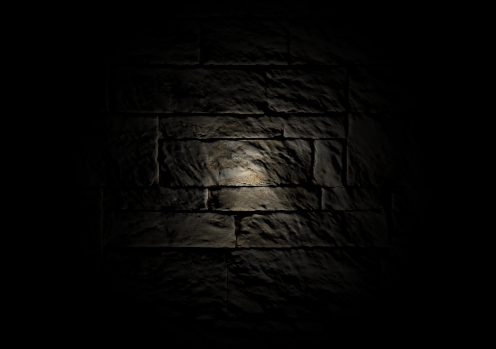
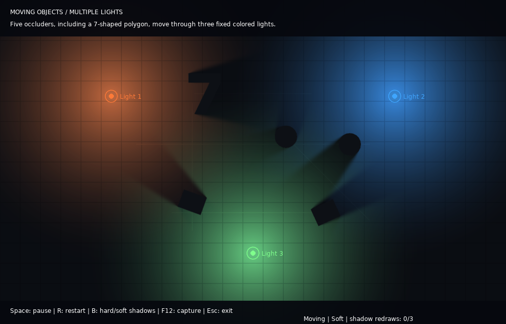
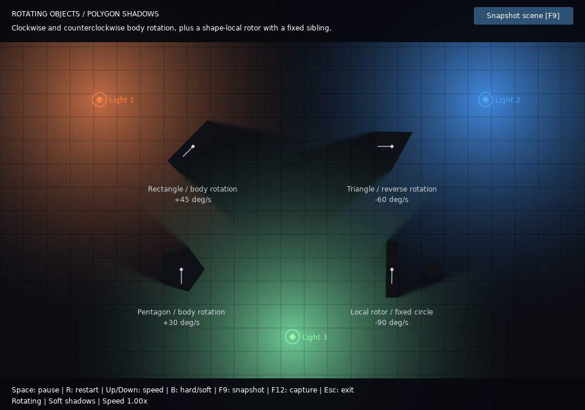

# Shädows

Shädows is a dynamic lighting and shadow library for LÖVE. It supports height-aware polygon and circle occluders, textured shadows, ambient-darkening rooms, and normal- and height-map effects.

Soft shadows use contact-hardening penumbras: edges stay sharp near the casting
shape and soften with distance from its silhouette. A minimum softness keeps
penumbras visible for positive source sizes even when the light is far from the
caster; larger sources can add more softness. The filter uses 90% of its
estimated radius for a slightly tighter transition, while 4x MSAA continues to
antialias diagonal silhouettes. Set `light.SizeRadius` (default `10`, in world
units) to control softness; `light.Blur = false` or
`light.SizeRadius = 0` preserves hard shadows.
The filter searches toward the light for a relevant blocker to avoid abrupt
softness changes where an unrelated nearby wall becomes the nearest silhouette,
including bright streaks along walls adjacent to a penumbra. It blends
candidate footprints and smooths the estimated blur radius to reduce bright
lines when the search crosses surfaces.
This applies to local lights and full-scene stars. See [Penumbras](docs/Penumbras.md)
for the filtering approximation, graphics requirements, and comparison demo.
Projected shadow render targets and occluder-mask canvases request 4x MSAA to smooth diagonal
edges, including when soft-shadow filtering is disabled.

## Cached updates

Lights retain a shared shadow canvas and cache projected geometry per shape and
height layer. Shape edits rebuild only that shape's geometry; moving a body
rebuilds its shapes. Local lights redraw shadows only when their influence
intersects a changed shape's previous or current bounds. Full-scene stars
redraw on scene changes. Affected canvases are still redrawn completely to
preserve overlapping shadows and height ordering.

Color, angular coverage, and light rotation changes reuse shadow pixels.
Changing `SizeRadius` reuses the occluder-distance field and updates only filter
radii and illumination. Changing the light position or radius rebuilds shadows;
local-light canvases resize with the radius.

Call `world:ForceUpdate()` when custom shadow/sprite callback output changes or
an existing texture's pixels change in place. Custom callbacks are not invoked
for appearance-only recomposition; force an update if they depend on light color,
arc, or rotation. See [Light](docs/Light.md) for rendering details.

## Color API migration

All light, star, ambient, and room color channels now use LÖVE's **0-1 range**.
This is a breaking change: divide legacy 0-255 arguments by 255 when updating
callers, including alpha (`255` becomes `1`). No legacy-range detection is
performed. For example, use `light:SetColor(1, 0.5, 0, 1)` for an orange light.
Radial lights apply RGB tint and opacity with premultiplied distance falloff.

## Source and setup

The editable library is in [`src/shadows`](src/shadows); its require name remains `shadows`. Add the source directory to LÖVE's require path before loading the library:

```lua
love.filesystem.setRequirePath(
    "src/?.lua;src/?/init.lua;" .. love.filesystem.getRequirePath()
)

local LightWorld = require("shadows.LightWorld")
local Light = require("shadows.Light")
local Body = require("shadows.Body")
local PolygonShadow = require("shadows.ShadowShapes.PolygonShadow")

local world
local light

function love.load()
    world = LightWorld:new()
    light = Light:new(world, 320)
    light:SetColor(1, 240 / 255, 200 / 255, 1)
    light:SetPosition(400, 300, 1.2)

    local body = Body:new(world)
    body:SetPosition(400, 300, 0.4)
    PolygonShadow:new(body, -32, -24, 32, -24, 32, 24, -32, 24)
end

function love.update(dt)
    world:Update(dt)
end

function love.draw()
    world:Draw()
end
```

The repository launcher and source demos configure the path for you. See the [API guide](docs/README.md) for all supported objects and methods.

## Demos

In VS Code, choose **Terminal > Run Task > Run LÖVE demo** and select a scene. Demos under `DEMOS/` load the shared library from `src/shadows`; they do not contain copies of the package.

The high-DPI regression scene can also be run from the repository root:

```powershell
love . HighDPI
love . HighDPI --capture
love . Penumbra --capture --verify
love . MovingObjects
love . MovingObjects --capture --verify
love . RotatingObjects
love . RotatingObjects --capture --verify
love . ImageShadow
love . ImageShadow --capture
love . CastImage
love . CastImage --capture --verify
```

Capture mode renders the scene to offscreen canvases at DPI scale 2, saves a screenshot using `love.graphics.captureScreenshot`, and exits. Press `F12` to capture an image interactively; press `Escape` to close the demo.

The `Penumbra` demo compares hard and soft polygon/circle shadows side by side;
use `+` and `-` to adjust the source radius and the arrow keys to move the light.
`--verify` checks measured contact and distant transition widths, minimum softness
at different source sizes and light distances, brightness preservation,
hard-shadow behavior, and DPI scales 1 and 2. Capture failures print a traceback and exit with a
nonzero status instead of opening an interactive error screen.
The same command checks granular cache work counts and exact pixel equality
between incremental updates and forced full rebuilds, including movement,
resizing, removal, texture replacement, tracked parents, and camera changes.

The `MovingObjects` demo continuously moves five circle/polygon objects,
including a concave 7-shaped polygon, back and forth under three fixed lights
at different positions, colored orange, blue, and green. Motion paths and light
markers show the scene layout; a counter reports
shadow-canvas redraws. Press `Space` to pause, `R` to restart, and `B` to switch
between hard and soft shadows. Capture mode uses a deterministic animation pose.
`--verify` checks both directions of motion, a complete loop, shadows from every
light, cache reuse while stationary, and pixel equality with forced rebuilds.
It also checks the seven's top bar, diagonal stem, and open notch throughout
its movement cycle, including hard-shadow rendering and unobstructed notch visibility.
Concave polygons are triangulated for silhouette drawing and shadow projection,
so the seven retains its open notch instead of being filled as a convex shape.

The `RotatingObjects` demo spins a rectangle, triangle, and pentagon in both
directions under three colored lights. A fourth example rotates only a polygon
inside its body while its circle sibling stays fixed. Pivot markers show
orientation. Press `Space` to pause, `R` to restart, `Up`/`Down` to adjust speed,
and `B` to toggle hard/soft shadows. `--verify` checks signed rotation angles,
full-loop periodicity, the fixed sibling, shadows from all three lights, and
pixel equality with full rebuilds for both hard and soft shadows.
Polygon shadow contours follow silhouette boundary order for lights below the
caster, preventing crossed triangles and missing shadow wedges as objects rotate.
The rotating-demo regression also checks the recorded pentagon defect at
89.706888 degrees and interior occlusion throughout a complete rotation.
Click **Snapshot scene [F9]** or press `F9` to pause and save a matching
`rotating-scene.png` and `rotating-scene.txt` without closing the demo. The text
records animation time, exact body/shape rotations, local and world polygon
vertices, all light settings, and window/canvas DPI. Both files are written to
the LÖVE save directory (on Windows, `%APPDATA%\LOVE\shadows`); the full path is
printed to the console. Share both files to reproduce an issue. The next
snapshot overwrites them; press `Space` to resume. Run
`love . RotatingObjects --capture --snapshot-verify` to validate the button and
matching screenshot/state output using temporary files.

The `ImageShadow` demo casts the silhouette and colors of a transparent flower
image onto a softly lit surface. Move the mouse to reposition the light, press
`B` to toggle soft shadows, `F12` to capture a screenshot, or `Escape` to exit.

The `CastImage` demo recreates a forest lighting scene with 17 original pixel-art
trees. Each upright tree casts an alpha-silhouette ground shadow, becomes dark
when backlit, and receives shadows from other trees. Press `M` to follow the
mouse with the light, `R` to reset it, or `B` to toggle soft ground shadows.
`--verify` checks every tree rather than a single representative caster.

Use [`CastImageShadow`](docs/CastImageShadow.md) for upright sprites, rather than
the flat textured mask provided by `ImageShadow`. Its bottom-center anchor is
the body's ground position; its height is measured in world units. Draw sprites
with `shape:DrawSprite()` in ground-depth order **after** `world:Draw()`, so
their illumination is not multiplied by their own ground shadows.

In the `Standard` demo, press `F9` to save a matching screenshot and scene
settings (`standard-scene.png` and `standard-scene.txt`) for reproducing
lighting issues. See [Standard demonstration](docs/Standard-Demonstration.md)
for the save location and controls.

## Lighting showcase

Scenes captured from the included demos, showing map lighting, contact-hardening
penumbras, height-map shadows, normal-map lighting, and moving/rotating occluders under
multiple colored lights.

| Standard map lighting | Contact-hardening penumbras |
| --- | --- |
|  |  |

| Height-map shadows | Normal-map lighting |
| --- | --- |
|  |  |

### Moving objects and multiple lights

Five objects, including a 7-shaped polygon, oscillate back and forth under three
fixed, colored lights in the
[`MovingObjects` demo](DEMOS/MovingObjects/main.lua).



### Rotating polygons

Clockwise and counterclockwise polygons cast changing shadows, with a separate
shape-local rotor and stationary circle in the
[`RotatingObjects` demo](DEMOS/RotatingObjects/main.lua).



## Tests

Install Busted with LuaRocks, then run the unit tests from the repository root:

```powershell
luarocks install busted --local
busted
busted spec/DPI_spec.lua spec/PenumbraSettings_spec.lua
```

On Windows, LuaRocks may need the MSVC C++ build tools to compile Busted's `luasystem` dependency.

## Documentation

Start with the [API and usage guide](docs/README.md), which indexes the class references and demonstrations in `docs/`.

## Project links

- [Issues](https://github.com/matiasah/shadows/issues)
- [LÖVE forum thread](https://love2d.org/forums/viewtopic.php?f=5&p=200615)
